# mplplots

A collection of Matplotlib styles, with the Personal style as the default, plus a toolkit for
publication figures: layouts in inches, color pairs, plot helpers, reproducible saving, and a
checker that tests a figure against its style. An agent skill and the style guide ship with the
package, so coding agents follow the same rules.

<table>
  <tr>
    <th>Matplotlib defaults</th>
    <th><code>mplplots.styles.Personal</code> + <code>auto_ticks</code></th>
  </tr>
  <tr>
    <td></td>
    <td>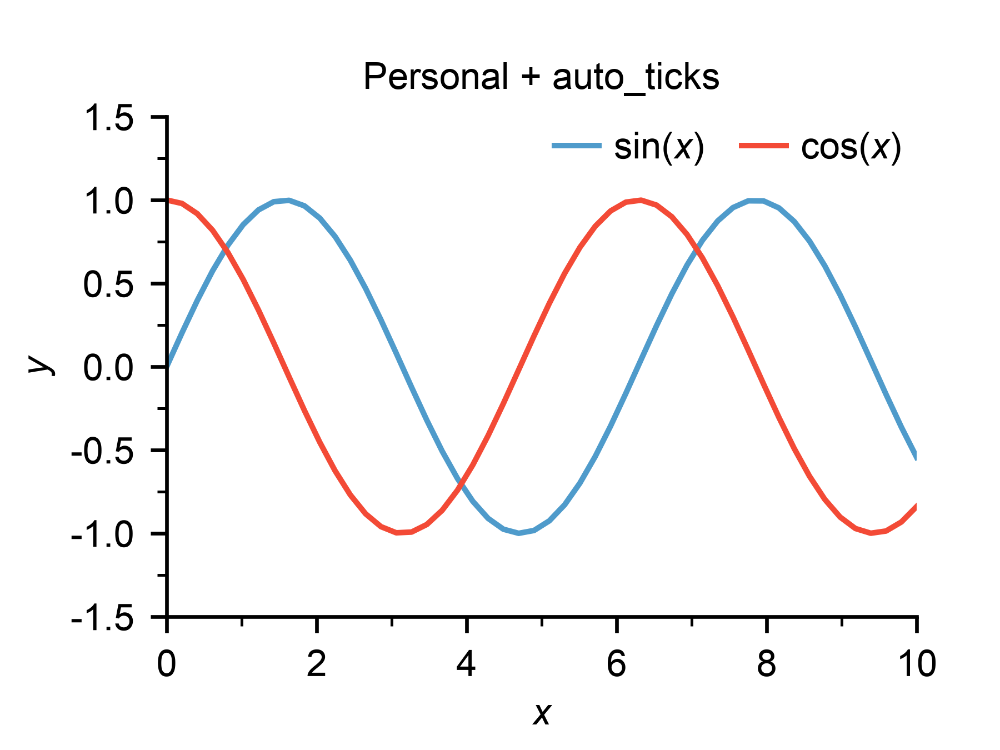</td>
  </tr>
</table>

## Installation

```bash
pip install git+https://github.com/FridrichMethod/mplplots.git
```

mplplots is not on PyPI. It needs Python 3.12 or newer and Matplotlib 3.8 or newer. To install a
release, append its tag, such as `...mplplots.git@v0.3.0`; [`CHANGELOG.md`](CHANGELOG.md) lists
what each release changed. Installing mplplots also installs the `mplplots` command (see
[For coding agents](#for-coding-agents)).

## Quick start

```python
import numpy as np

import mplplots as mpp

mpp.use()  # the Personal style, before the first figure is created

TREATED = mpp.ColorPair(fill="#c7e9c0", edge="#4f9d58")  # one role of a project palette

t = np.linspace(0, 10, 101)
mean, sem = 1 - np.exp(-t / 2), np.full_like(t, 0.05)

fig, (ax,) = mpp.grid_inches(width=2.5, height=1.5)  # 2.5 by 1.5 in axes in a 3.3 by 2 in figure
mpp.plot_mean_sem(ax, t, mean, sem, fill=TREATED.fill, edge=TREATED.edge, label="Treated")
ax.set(xlim=(0, 10), ylim=(0, 1.2), xlabel="Time (s)", ylabel="Signal (a.u.)")
ax.legend()

mpp.assert_figure(fig)  # raises StyleError if the figure breaks a rule of the style
mpp.save_figure(fig, "figures/signal", caption="Mean of n = 6 replicates; the band is 1 SEM.")
```

`save_figure` writes `figures/signal.png` (600 dpi), `.pdf` and `.svg`, each exactly 3.3 by 2 in,
and the caption draft `figures/signal_caption.txt`. The functions and constants of the styles and
the toolkit are all importable from the top-level package, as `mpp.<name>`; the palettes live in
`mplplots.palettes`.

## Styles

| Style | Dotted name | What it is |
| --- | --- | --- |
| `Personal` | `mplplots.styles.Personal` | The default. Arial Regular 8 pt throughout, 0.8 pt axis lines and ticks with minor ticks, and no top or right spines. See [What the Personal style changes](#what-the-personal-style-changes). |
| `GraphPadPrism` | `mplplots.styles.GraphPadPrism` | A style inspired by GraphPad Prism: Arial Regular 8 pt, with 1 pt axis lines, ticks, and data lines. Its values were chosen by eye and are not measured from GraphPad Prism's defaults. See [What the GraphPadPrism style changes](#what-the-graphpadprism-style-changes). |

`mplplots styles` prints the same list with the path of each style file. In Python,
`mplplots.STYLES` holds the names, `mplplots.DEFAULT_STYLE` is `"Personal"`, and
`mplplots.style_path(name)` returns a style's file.

### Applying a style

```python
import matplotlib.pyplot as plt

import mplplots as mpp

mpp.use()  # the Personal style, for the rest of the session
mpp.use("GraphPadPrism")  # another packaged style, by name

with mpp.context("GraphPadPrism"):  # a style for one block only
    fig, ax = plt.subplots()
    ax.plot([1, 2, 3], [1, 4, 9])
```

`mpp.use` and `mpp.context` raise `ValueError` for a name that is not in `mplplots.STYLES`. Apply a
style before you create the figure: Matplotlib reads the settings when it creates an artist, so a
figure made earlier keeps the old look.

Matplotlib also loads each style by its dotted package name, so a script can use one without
importing mplplots:

```python
import matplotlib.pyplot as plt

plt.style.use("mplplots.styles.Personal")  # for the rest of the session

with plt.style.context("mplplots.styles.GraphPadPrism"):  # for one block only
    fig, ax = plt.subplots()
    ax.plot([1, 2, 3], [1, 4, 9])
```

`mplplots.STYLE_PATH` is the path of `GraphPadPrism.mplstyle`, and `mplplots.prism_style()` applies
it, as `mpp.use("GraphPadPrism")` does.

Styles can be combined. Later entries override earlier ones, so put an mplplots style last to keep
its fonts, spines, and sizes on top of another style (here, seaborn's white grid):

```python
import matplotlib.pyplot as plt

plt.style.use(["seaborn-v0_8-whitegrid", "mplplots.styles.Personal"])
```

Seaborn plots draw under the style without any seaborn setup. If you call `sns.set_theme(...)`,
apply the style after it, because `set_theme` rewrites the same settings:

```python
import seaborn as sns

import mplplots as mpp

sns.set_theme(style="ticks")
mpp.use()
```

**Without installing mplplots.** Each style is an ordinary, self-contained Matplotlib style file in
[`src/mplplots/styles/`](src/mplplots/styles/). You can copy
[`Personal.mplstyle`](src/mplplots/styles/Personal.mplstyle) anywhere and load it with
`plt.style.use("path/to/Personal.mplstyle")`. You can also put it in the `stylelib/` folder of your
Matplotlib config directory (`matplotlib.get_configdir()`) and use `plt.style.use("Personal")` from
any project.

### What the Personal style changes

| Area | Settings |
| --- | --- |
| Figure | No figure size is set. Saved at 600 dpi and shown on screen at 150 dpi. Saved files are not cropped, so they keep the figure's size; pass `bbox_inches="tight"` to `savefig` to crop to the drawn content. |
| Text | Arial Regular 8 pt (see [Fonts](#fonts)) for every text element: tick labels, axis labels, axes and figure titles, figure-level labels, and the legend and its title. Math text (`$...$`) uses the same font: variables such as `$x$` in Arial Italic, and function names such as `$\sin$`, numbers, and operators upright. Negative tick labels use the ASCII hyphen-minus. Axis labels sit 3 pt from the tick labels. |
| Vector output | PDF and PostScript embed fonts as TrueType (Type 42), so text stays editable and passes journal checks that reject Type 3 fonts. SVG stores glyphs as paths. |
| Axes | 0.8 pt axis lines, with the top and right spines removed. Autoscaled limits are rounded out to tick values. |
| Ticks | Major ticks 0.8 pt wide and 3.5 pt long, minor ticks 0.6 pt wide and 2 pt long, with minor ticks shown on both axes. |
| Lines & markers | 2 pt lines; give each curve its own width when several share a panel. 3 pt markers, black unless the call sets their colors. 0.5 pt patch edges. Error bars have 3 pt caps. |
| Legend | No frame, placed in the upper right, with short handles (1.2 font sizes) and tight spacing. |

For every setting, see the [style file](src/mplplots/styles/Personal.mplstyle).

### What the GraphPadPrism style changes

| Area | Settings |
| --- | --- |
| Figure | No figure size is set. Saved at 600 dpi and shown on screen at 300 dpi. Saved files are not cropped, so they keep the figure's size; pass `bbox_inches="tight"` to `savefig` to crop to the drawn content. |
| Text | Arial Regular 8 pt (see [Fonts](#fonts)) for every text element: tick labels, axis labels, axes and figure titles, and the legend and its title. Math text (`$...$`) uses the same font: variables such as `$x$` in Arial Italic, and function names such as `$\sin$`, numbers, and operators upright. |
| Vector output | PDF and PostScript embed fonts as TrueType (Type 42), so text stays editable and passes journal checks that reject Type 3 fonts. SVG stores glyphs as paths. |
| Axes | 1 pt axis lines, with the top and right spines removed. Autoscaled limits are rounded out to tick values. |
| Ticks | 1 pt major and minor ticks, with minor ticks shown on both axes. |
| Lines & markers | 1 pt lines, also used for error bars. Markers take the color of their line. Error bars have 3 pt caps. |
| Legend | No frame, placed in the upper right. |

For every setting, see the [style file](src/mplplots/styles/GraphPadPrism.mplstyle).

### Fonts

Both styles ask for Arial. If Arial is not installed (common on Linux and HPC clusters), they fall
back without warnings to Helvetica or an Arial-compatible clone (Liberation Sans, Arimo, Nimbus
Sans), and finally to DejaVu Sans, which ships with Matplotlib. Math text follows the same chain.
The styles also set `font.family` to `sans-serif`, so they use this list even if your
`matplotlibrc` picks another font family. For final figures, install Arial, or register the font
files at the start of your script or notebook, before plotting:

```python
from mplplots import add_custom_fonts

add_custom_fonts("/path/to/Arial.ttf", "/path/to/Arial Italic.ttf", "/path/to/Arial Bold.ttf")
```

`add_custom_fonts` registers the files for the current Python session only. The styles use the
regular face for text and the italic face for variables in math text. Register the bold face as
well for bold text you add, such as `fontweight="bold"` or `$\mathbf{...}$`. Matplotlib caches its
font list. If you install Arial system-wide after Matplotlib has already run, delete the
`fontlist-*.json` file in `matplotlib.get_cachedir()` so the list is rebuilt. Without Arial,
[`check_figure`](#checking-a-figure) reports one `font-fallback` warning per figure.

Write variables and formulas in labels, titles, and legends as math text, so they are set in
italic like an equation: `ax.set_xlabel("$x$")` and `label=r"$\sin(x)$"`, not `"x"` and `"sin(x)"`.
Math text uses Matplotlib's built-in TeX parser, so it needs no LaTeX installation.

## Color palettes

`mplplots.palettes` provides 25 hand-picked palettes of 11 colors each, and six single-hue families
sampled from Matplotlib colormaps. Every palette is a plain tuple of hex strings. You can index or
slice it and pass it anywhere Matplotlib or seaborn accepts colors.

| Group | Palettes |
| --- | --- |
| Mixed hues | `CUSTOM`, `PASTEL`, `WARM`, `COOL`, `EARTH` |
| Single color family (from `CUSTOM`) | `OCEAN`, `ROSE`, `FOREST`, `LAVENDER`, `SUNSET`, `COASTAL` |
| Seasonal | `SPRING`, `SUMMER`, `AUTUMN`, `WINTER` |
| Time of day | `DAWN`, `DUSK` |
| Thematic | `CANDY`, `SMOKE`, `VINTAGE`, `NORDIC`, `MEADOW`, `CORAL`, `TROPICAL`, `POWDER` |

<details>
<summary>Show all 25 palettes</summary>

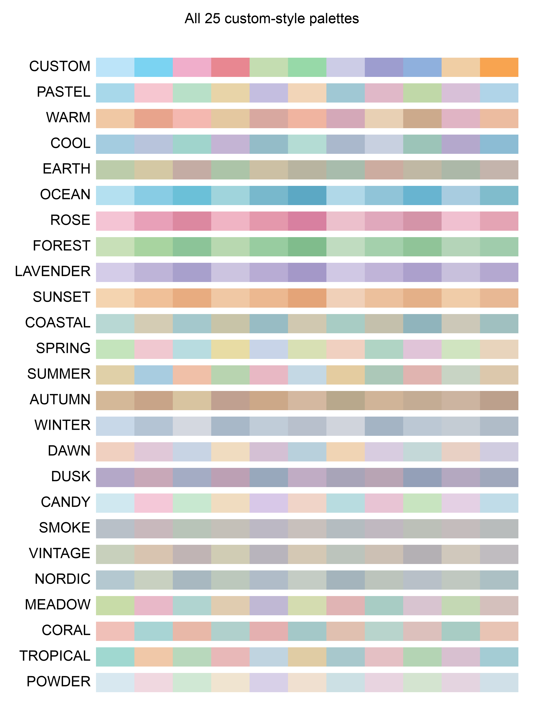

</details>

The colormap families `BLUES`, `GREENS`, `REDS`, `PURPLES`, `ORANGES`, and `GREYS` each have 8
shades running from light to dark. Their colors are sampled from the matching Matplotlib colormap
between 0.3 and 0.8 (0.25 and 0.75 for `GREYS`), which skips near-white and near-black.

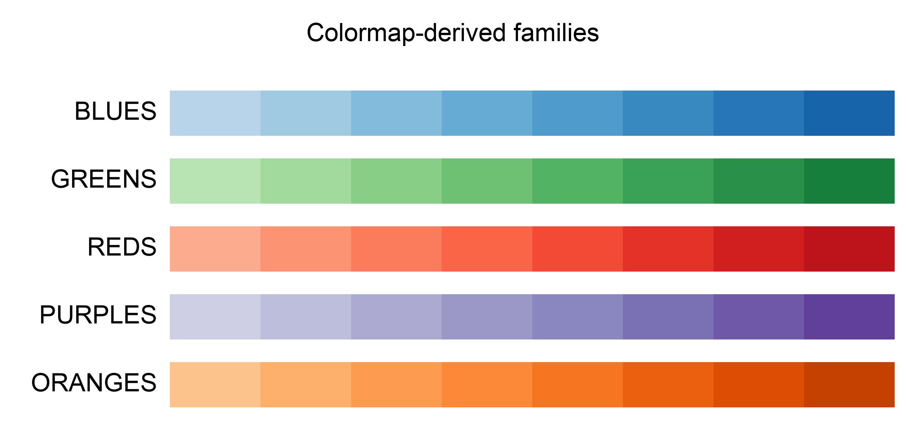

### Using a palette

```python
import matplotlib.pyplot as plt
import numpy as np

import mplplots as mpp
from mplplots.palettes import BLUES, OCEAN

mpp.use()

x = np.linspace(0, 10, 100)
fig, (ax1, ax2) = plt.subplots(1, 2)
ax1.plot(x, np.sin(x), color=OCEAN[0])  # a single color
for i, color in enumerate(OCEAN[1:4]):  # a slice
    ax1.plot(x, np.sin(x + i + 1), color=color)
ax2.bar(["A", "B", "C"], [3, 5, 4], color=BLUES[2:5])
```

### Making a palette the default color cycle

`set_palette` sets Matplotlib's color cycle (`rcParams["axes.prop_cycle"]`), so a palette applies
without passing `color=` on every call. `PALETTES` maps every palette name to its colors.

```python
import mplplots as mpp
from mplplots.palettes import PALETTES, set_palette

mpp.use()
set_palette("ocean")  # palette name, case-insensitive
set_palette(["#000000", "#E69F00"])  # or any sequence of colors

PALETTES["OCEAN"]  # read-only mapping: UPPER-CASE name -> tuple of hex colors
sorted(PALETTES)  # every named palette, including the six colormap families
```

An unknown name raises `ValueError`. The new cycle applies to axes created after the call. Call
`set_palette` after `mpp.use()`, because a style that defines its own color cycle would replace
it.

To step through a palette by hand, create a cycle over it:

```python
from itertools import cycle

from mplplots.palettes import OCEAN

colors = cycle(OCEAN)
```

### Sampling any colormap

`get_colors(name, n, start=0.2, end=0.8)` returns `n` evenly spaced hex colors from any registered
Matplotlib colormap. The default range skips the extreme ends of the colormap, and `n=1` returns
the color at the midpoint.

```python
from mplplots.palettes import get_colors

get_colors("viridis", 5)  # 5 colors between 0.2 and 0.8 of viridis
get_colors("coolwarm", 6, start=0.15, end=0.85)  # a wider range
get_colors("Blues_r", 3)  # reversed colormaps work too
get_colors("viridis", 5, start=0.8, end=0.2)  # or sample in reverse order
```

`n` must be at least 1, and `start` and `end` must be between 0 and 1. Otherwise, and for an
unknown colormap name, `get_colors` raises `ValueError`.

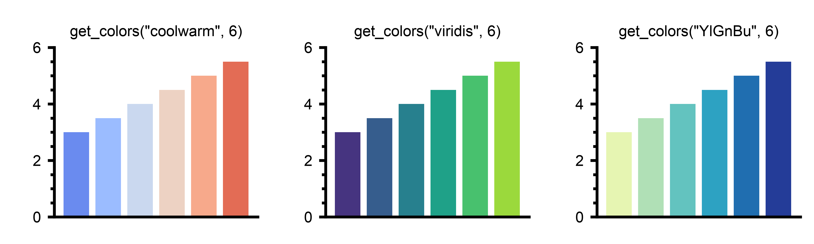

## Color pairs

`mplplots.colors` holds the color rules of the Personal style. A project keeps its colors in one
palette module that maps each role (a condition, a sample, a reference) to a `ColorPair`. The
edge carries the role's identity: lines, marker edges, bar borders. The fill is its pale partner,
drawn under alpha: bands, bar faces, scatter faces.

```python
import mplplots as mpp

REFERENCE = mpp.ColorPair(fill="#cccccc", edge="#7a7a7a")
TREATED = mpp.ColorPair(fill="#c7e9c0", edge="#4f9d58")
PALETTE = {"reference": REFERENCE, "treated": TREATED}

fill, edge = TREATED  # a ColorPair unpacks as fill, edge
assert mpp.check_palette(PALETTE) == []  # put this in the project's tests

mpp.lighten("#dd6692", 0.3)  # '#efb5ca': HLS lightness times 1.3
mpp.darken("#006d2c", 0.25)  # '#005221': HLS lightness times 0.75
mpp.contrast_ratio("#4f9d58", alpha=mpp.LINE_ALPHA)  # 3.11: WCAG contrast on white
```

- `lighten(color, amount=0.4)` and `darken(color, amount=0.3)` multiply the HLS lightness by
  `1 + amount` or `1 - amount` and return a lowercase `#rrggbb`. Use them to derive a further
  member of a hue family instead of adding a new color.
- `relative_luminance(color)` is the WCAG relative luminance, and
  `contrast_ratio(color, background="white", *, alpha=1.0)` the WCAG contrast ratio of `color`
  drawn at `alpha` over `background`.
- `check_palette(palette, *, min_edge_contrast=3.0, alpha=LINE_ALPHA, floors=None)` returns one
  message per violation and an empty list for a sound palette: an edge that is not darker than its
  fill, two roles that share an edge color, or an edge whose contrast on white, drawn at `alpha`,
  is below 3. `floors={"role": 1.8}` gives a lighter warm hue (a yellow, say) its own floor.

| Constant | Value | Use |
| --- | --- | --- |
| `SCATTER_ALPHA` | `0.6` | Scatter dots, histogram and density fills |
| `BAND_ALPHA` | `0.5` | Mean +/- SEM bands and confidence bands |
| `LINE_ALPHA` | `0.95` | Curves |
| `REFERENCE_LINE` | `{"color": "0.55", "linestyle": "--", "linewidth": 0.8}` | Reference and threshold lines: `ax.axhline(1.0, **mpp.REFERENCE_LINE)` |
| `SECONDARY_LINESTYLE` | `(0, (4, 2))` | The dash pattern of a second variable within one hue |

## Ticks: `auto_ticks`

```python
import matplotlib.pyplot as plt

import mplplots as mpp

mpp.use()

fig, ax = plt.subplots()
ax.bar(["A", "B", "C"], [23, 45, 12])
mpp.auto_ticks(ax, bottom=0)  # call after plotting; keep the y-axis starting at 0
```

`auto_ticks(ax, left=..., right=..., bottom=..., top=...)` gives both axes Prism-like ticks. On a
linear axis of numbers:

- **Major ticks:** about six, spaced 1, 2, 2.5, or 5 times a power of 10 (the same spacings as
  Matplotlib's default ticks).
- **Minor ticks:** fewer major ticks get more minor ticks. Six or more visible major ticks get 1
  minor tick halfway between. Five or fewer get 3 or 4, whichever keeps them on round values:
  every 1 between 0 and 5, every 0.5 between 0 and 2, every 0.25 or 0.2 between 0 and 1.
- **Limits:** each axis starts and ends on a major tick, never on a bare stretch of axis line.
  - A limit you leave unset moves out to the nearest major tick.
  - A limit you pass (`left`, `right`, `bottom`, or `top`, for example `bottom=0` for bar charts)
    is kept exactly, and the tick spacing is chosen so that it is a major tick too: `right=7`
    gives a tick every 1. If no round spacing with at most 10 intervals fits (for example
    `bottom=-1.2`), that end stays between ticks.
  - Inverted axes stay inverted. The limits mean the same as in `ax.set_xlim(left, right)` and
    `ax.set_ylim(bottom, top)`, so on an inverted y-axis `bottom` is the larger value.

Other axes keep Matplotlib's own tick positions:

- **Log and other non-linear scales, dates, and other units:** unset limits also move out to the
  nearest major tick, so a log axis runs from one labeled decade to another.
- **Categorical axes** (string data, such as the `"A"`, `"B"`, `"C"` above) keep one tick per
  category and lose their minor ticks. Their limits are not changed, so the axis line extends
  half a category past the outer bars.

A limit you pass is applied to every kind of axis.

Call it **after** plotting your data, because it works from the limits the data produce. It
replaces the major tick locators of linear numeric axes. If you set custom tick positions or
labels on such an axis (for example, the group labels of a grouped bar chart with numeric bar
positions), set them after calling `auto_ticks`.

## Layout in inches

GraphPad Prism sets the length of each axis directly, instead of deriving it from the figure size
and margins. `add_axes_inches` does the same: it places axes at a position and size given in
inches from the figure's lower-left corner, so the x- and y-axes are exactly as long as you ask.
`legend_inches` and `suptitle_inches` place a legend and a figure title in inches too. All three
keep their place when the figure is resized and at any dpi, and because the styles do not crop
saved figures, the saved file has exactly the figure's size.

```python
import matplotlib.pyplot as plt
import numpy as np

import mplplots as mpp
from mplplots.palettes import BLUES, REDS

mpp.use()

x = np.linspace(0, 10, 50)
fig = plt.figure(figsize=(3, 2.25))  # the saved file is 3 by 2.25 in
ax = mpp.add_axes_inches(fig, left=0.5, bottom=0.4, width=2.25, height=1.5)  # 2.25 by 1.5 in axes
ax.plot(x, np.sin(x), color=BLUES[4], linewidth=1.2, label=r"$\sin(x)$")
ax.plot(x, np.cos(x), color=REDS[4], linewidth=1.2, label=r"$\cos(x)$")
mpp.auto_ticks(ax, left=0, right=10)
ax.set_xlabel("$x$")
ax.set_ylabel("$y$")
mpp.legend_inches(ax, 2.75, 1.9, loc="upper right", ncols=2)  # upper-right corner at (2.75, 1.9) in
fig.savefig("figure.pdf")
```

- `add_axes_inches(fig, left, bottom, width, height, **kwargs)` adds axes whose x-axis is
  `width` and y-axis `height` inches long, meeting at (`left`, `bottom`). Other keyword arguments
  go to `fig.add_axes`.
- `legend_inches(ax, x, y, loc="upper left", **kwargs)` places the point of the legend box that
  `loc` names at (`x`, `y`): a corner (`"upper left"`), the middle of an edge (`"center left"`),
  or `"center"`. Other keyword arguments, such as `ncols` or `title`, go to `ax.legend`.
- `suptitle_inches(fig, t, top=0.1, **kwargs)` adds a centered figure title whose top edge is
  `top` inches below the figure's top edge.

The Personal image at the top of this README uses the layout above, plus a title.

`mplplots.layout` builds whole figures this way. `grid_inches` makes a figure and a grid of axes
from axis lengths, margins, and gaps, all in inches, and derives the figure size from them:

```python
import numpy as np

import mplplots as mpp

mpp.use()

# Three stacked panels with 2.5 by 0.8 in axes, 0.2 in apart and sharing both axes:
# a 3.3 by 3.3 in figure.
fig, axes = mpp.grid_inches(3, 1, width=2.5, height=0.8, hspace=0.2, sharex=True, sharey=True)
t = np.linspace(0, 10, 201)
series = [("Slow", 1, "#7a7a7a"), ("Intermediate", 2, "#4f9d58"), ("Fast", 4, "#3182bd")]
for ax, (label, k, color) in zip(axes, series):
    ax.plot(t, np.sin(k * t), color=color, linewidth=1.2, label=label)
    ax.legend()
axes[0].set(xlim=(0, 10), ylim=(-1, 2))  # shared: headroom for the legends above the curves
axes[-1].set_xlabel("Time (s)")
mpp.add_shared_ylabel(fig, axes, "Signal (a.u.)")
mpp.align_legends_left(axes)  # the three legends start at the same x
```

- `grid_inches(nrows=1, ncols=1, *, width, height, left=0.6, right=0.2, top=0.1, bottom=0.4,
  wspace=0.6, hspace=0.5, sharex=False, sharey=False, **figure_kwargs)` returns the figure and its
  axes as a flat list, top row first. `width` is the x-axis length of each column and `height` the
  y-axis length of each row; a number applies to all, a sequence gives one per column or row, and
  so do `wspace` and `hspace` for the gaps. The figure is `left + sum(width) + sum(wspace) + right`
  wide and `top + sum(height) + sum(hspace) + bottom` tall. `sharex` and `sharey` keep tick labels
  on the bottom row and the left column only, as `plt.subplots` does.
- `figure_size(width="single", *, height=None, aspect=None)` returns a figure size for a journal
  column preset (`COLUMN_WIDTHS`: `"single"` 3.5 in, `"onehalf"` 5 in, `"double"` 7 in) or a
  width in inches. `height` wins over `aspect`, which defaults to 0.7: `figure_size()` is
  `(3.5, 2.45)` and `figure_size("double", aspect=0.5)` is `(7.0, 3.5)`.
- `add_shared_ylabel(fig, axes, text)` adds one y label for a stack or grid of panels, at the gap
  an ordinary `ax.set_ylabel` would leave from the leftmost tick labels. For a shared x label, use
  the bottom panel's `set_xlabel`.
- `align_legends_left(axes, *, right=0.985, y=0.97)` gives the legends of several panels a common
  left edge, so legends of different widths line up. Call it after the legends are drawn.

With 8 pt text, 0.5 to 0.6 in to the left of the axes fits the tick labels and a y-axis label,
0.4 in below fits the tick labels and an x-axis label, 0.2 in to the right holds the label of a
tick at the end of the x-axis, and 0.35 in above fits an axes title. These are the defaults of
`grid_inches`, apart from the title space (`top=0.35`).

The axes keep their position through an axes locator, so `tight_layout`, constrained layout,
`ax.set_position`, and the space `fig.colorbar(..., ax=ax)` takes do not move them. For a
colorbar, add its axes with `add_axes_inches` and pass them as `cax`, and give its outline the
minor tick width (`colorbar.outline.set_linewidth(0.6)` in the Personal style).

## Plot helpers

`mplplots.plots` draws the elements that the Personal style guide asks for in a fixed form:

- `plot_mean_sem(ax, x, mean, sem, *, fill, edge, label=None, linewidth=1.2, linestyle="-", ...)`
  draws a borderless `mean +/- sem` band in `fill` under the mean curve in `edge`, and returns the
  curve. A second state of the same role takes `linestyle=mpp.SECONDARY_LINESTYLE`.
- `plot_distribution(ax, edges, counts, n_total, *, fill, edge, ...)` draws pre-binned counts as a
  curve through the bin centers, filled to zero, in percent of all `n_total` samples per bin. It
  returns a legend proxy with the same face, edge, and line width.
- `significance_stars(p)` returns `"***"` below 0.001, `"**"` below 0.01, `"*"` below 0.05, and
  `"n.s."` otherwise, also for NaN. Pass the multiplicity-corrected value.
- `box_axes(ax)` shows all four spines with ticks on the left and bottom only, for a panel that is
  meant to be boxed.

```python
import numpy as np

import mplplots as mpp

mpp.use()
REFERENCE = mpp.ColorPair(fill="#cccccc", edge="#7a7a7a")
TREATED = mpp.ColorPair(fill="#c7e9c0", edge="#4f9d58")

rng = np.random.default_rng(0)
edges = np.linspace(0, 6, 31)  # one bin grid for both series
fig, (ax,) = mpp.grid_inches(width=2.5, height=1.5)
proxies = []
# The reference is drawn on top of the series it overlaps (zorder 4 over 2).
for loc, n, pair, zorder in [(2.2, 5000, REFERENCE, 4), (3.6, 4000, TREATED, 2)]:
    counts, _ = np.histogram(rng.normal(loc, 0.6, n), edges)
    proxies.append(
        mpp.plot_distribution(ax, edges, counts, n, fill=pair.fill, edge=pair.edge, zorder=zorder)
    )
ax.legend(proxies, ["Reference", "Treated"])
ax.set(xlim=(0, 6), ylim=(0, 20), xlabel="Distance (\u00c5)", ylabel="Percent of samples")
```

## Saving figures

`mplplots.export.save_figure` saves a figure the way the style guide asks:

```python
import mplplots as mpp

mpp.use()
fig, (ax,) = mpp.grid_inches(width=2.0, height=1.5)
ax.plot([0, 1, 2], [0, 1, 4], color="#4f9d58", linewidth=1.2)
paths = mpp.save_figure(fig, "figures/fig01", caption="Signal after the pulse.")
# figures/fig01.png, figures/fig01.pdf, figures/fig01.svg, figures/fig01_caption.txt
```

- `path` is the output path without an extension; each format's extension is appended, and
  missing directories are created. `formats` defaults to `("png", "pdf", "svg")` (`mpp.FORMATS`).
- The files have the figure's exact size, whatever `savefig.bbox` your `matplotlibrc` sets.
  `crop=True` trims them to the drawn content with a 0.02 in margin instead.
- Raster files use `rcParams["savefig.dpi"]` (600 under both styles) unless you pass `dpi`.
- Output is reproducible: the PDF and SVG carry no date, so saving the same figure again writes the
  same bytes, and a file that changes under version control is a figure that changed. The raster
  formats (PNG, TIFF, JPEG, WebP, ...) and PGF are reproducible too; SVGZ, PS and EPS, which
  `formats` also accepts, record the time of the save.
- SVG stores text as paths, so it looks the same on a machine without Arial;
  `editable_svg_text=True` keeps it as text. The PDF keeps text editable (TrueType).
- A non-empty `caption` is written to `<path>_caption.txt`. The figure is closed afterward unless
  `close=False`. It returns the written paths, in the order of `formats`, then the caption file.

## Checking a figure

`mplplots.check` turns the mechanical rules of the style guide into code. `check_figure(fig)`
returns a list of `Issue(rule, severity, message)`, reading the expected values (font size, font
list, spine width, hidden spines, legend frame, minus sign) from the style file, so it follows the
style instead of restating it. `assert_figure(fig)` raises `StyleError` listing every error and
emits one `StyleWarning` per warning; `warnings_as_errors=True` fails on warnings too.

```python
import numpy as np

import mplplots as mpp

mpp.use()
fig, (ax,) = mpp.grid_inches(width=2.0, height=1.5)
mpp.box_axes(ax)
ax.plot(np.arange(10), np.arange(10) ** 0.5, color="#4f9d58", linewidth=1.2)
ax.set_xlim(0, 9)

for issue in mpp.check_figure(fig):
    print(issue.rule, issue.severity, issue.message)
# A boxed panel is a requested exception, so its top and right spines are not an issue.
mpp.assert_figure(fig, ignore={"open-spines"})
```

Both take `style=` to check against another packaged style (`"Personal"` by default), `ignore=`
to skip rule ids, `allow_font_sizes=` for sizes accepted besides the style's `font.size`, and
`allow_font_weights=` for weights accepted besides regular, such as a bold callout. Pass any of
the three only with the reason in a comment. They inspect only drawn artists and handle polar and
3D axes, colorbars, twin axes, and log scales. `mplplots.RULES` maps each rule id to a one-line
description.

| Rule id | Severity | Reports |
| --- | --- | --- |
| `font-size` | error | Text whose size is neither the style's `font.size` nor in `allow_font_sizes` |
| `font-weight` | error | Text whose weight is neither regular nor in `allow_font_weights` |
| `font-family` | error | Text that resolves to a font outside the style's `font.sans-serif` list |
| `font-fallback` | warning | The style's first-choice font is not installed, so text renders in a fallback (once per figure) |
| `script-glyph` | error | Text with a precomposed superscript or subscript character, such as U+00B2; write `$^2$` |
| `unicode-minus` | warning | Text with the Unicode minus sign (U+2212) when the style uses the ASCII hyphen-minus |
| `spine-width` | error | A visible spine whose width differs from the style's `axes.linewidth`, or a colorbar outline whose width differs from the minor tick width |
| `open-spines` | warning | A visible top or right spine where the style hides it |
| `legend-frame` | error | A legend with a frame when the style has none |
| `layout-engine` | error | A figure with a layout engine (tight or constrained) |
| `round-inches` | warning | A figure size, or an axes position or size, off the 0.05 in grid |
| `off-canvas` | error | Text or a legend that extends beyond the canvas, which an uncropped file cuts off |
| `text-overlap` | warning | Texts whose drawn boxes overlap each other; a text at an angle other than a multiple of 90 degrees is not compared |
| `panel-letter` | warning | Text other than a tick label that is a single letter, such as `a`, `B`, or `(c)` |
| `default-color` | warning | A line, patch, or collection in one of Matplotlib's ten default-cycle colors |

The other rules of the style guide are judgment, such as what a color means or whether a legend
covers data. Check those by looking at the saved PNG at print size.

## For coding agents

mplplots ships an agent skill for Claude Code and Codex, a rules snippet for a project's
`AGENTS.md`, and the [style guide](src/mplplots/data/skills/mplplots/references/style-guide.md):
the Personal style's rules for typography, lines and marks, color, layout, statistics, and export,
each with an id (T1, L4, C7, ...). The [skill](src/mplplots/data/skills/mplplots/SKILL.md) gives an
agent a six-step workflow: apply the style, take colors from the project palette, lay out in
inches, draw, `assert_figure`, `save_figure`.

```bash
mplplots install-skill --project .           # the skill, for Claude Code and Codex
mplplots install-skill --project . --rules   # also the rules, for Claude Code
mplplots install-skill --project . --check   # exit 1 if a copy is missing or out of date
mplplots rules >> AGENTS.md                  # the rules, for Codex
mplplots guide                               # print the style guide
```

`install-skill` writes `.claude/skills/mplplots/` (Claude Code) and `.agents/skills/mplplots/`
(Codex) in the project, each with `SKILL.md` and `references/style-guide.md`. `--client claude` or
`--client codex` limits it to one agent. `--rules` also writes `.claude/rules/mplplots.md`; Codex
reads no rules file, so for Codex it prints a hint to append `mplplots rules` to `AGENTS.md`
instead. Each `SKILL.md` copy names the mplplots version that wrote it, and running the command
again after an upgrade refreshes the copies. It prints one line per copy, `written` or
`unchanged`, and writes nothing outside the project.

`mplplots --version` prints the installed version, and `python -m mplplots` runs the same command.

## Gallery

Generated by [`examples/personal_demo.py`](examples/personal_demo.py), which also produces the
Personal image at the top of this README. Every figure passes `assert_figure`:

<table>
  <tr>
    <td></td>
    <td></td>
  </tr>
  <tr>
    <td><code>plot_mean_sem</code> bands, a second state in <code>SECONDARY_LINESTYLE</code>, and a <code>REFERENCE_LINE</code> threshold</td>
    <td><code>plot_distribution</code> curves with their legend proxies</td>
  </tr>
  <tr>
    <td>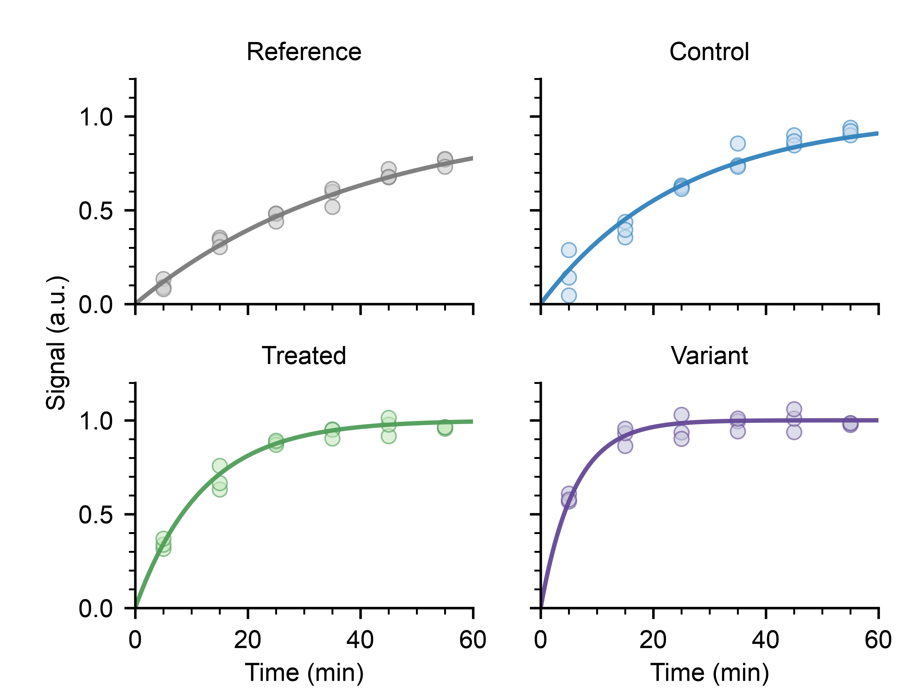</td>
    <td>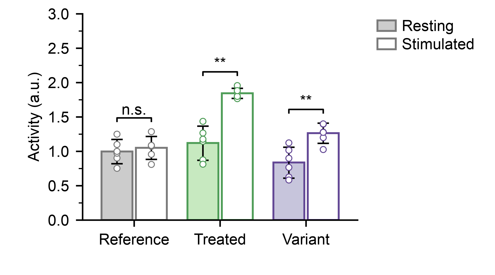</td>
  </tr>
  <tr>
    <td>A 2 by 2 <code>grid_inches</code> layout with shared axes and <code>add_shared_ylabel</code></td>
    <td>Filled and hollow bars, 95% confidence intervals, replicates, and <code>significance_stars</code></td>
  </tr>
</table>

Generated by [`examples/styles_demo.py`](examples/styles_demo.py), in the GraphPadPrism style:

<table>
  <tr>
    <td>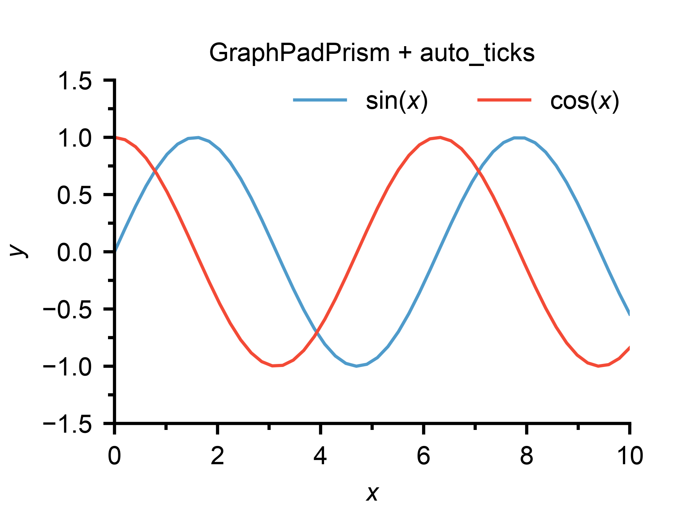</td>
    <td>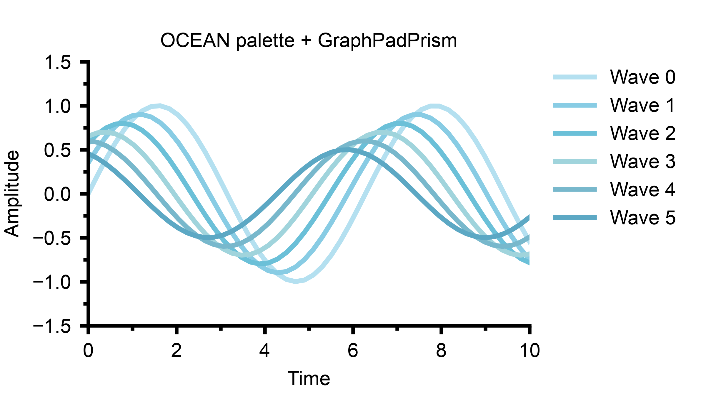</td>
  </tr>
  <tr>
    <td>The comparison plot in the GraphPadPrism style</td>
    <td>Phase-shifted waves in <code>OCEAN</code></td>
  </tr>
  <tr>
    <td></td>
    <td>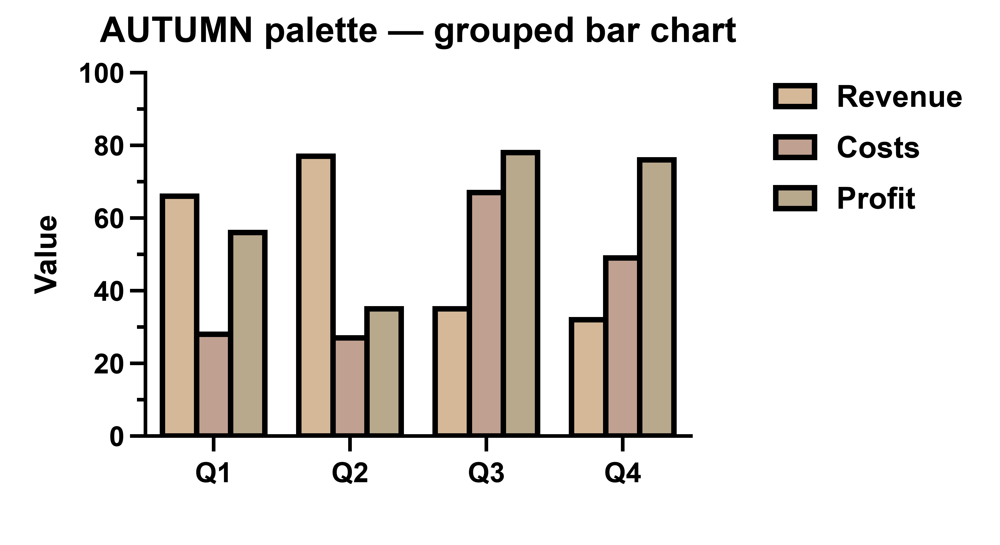</td>
  </tr>
  <tr>
    <td>Bar chart colored with <code>BLUES[:5]</code></td>
    <td>Grouped bar chart in <code>AUTUMN</code></td>
  </tr>
  <tr>
    <td colspan="2">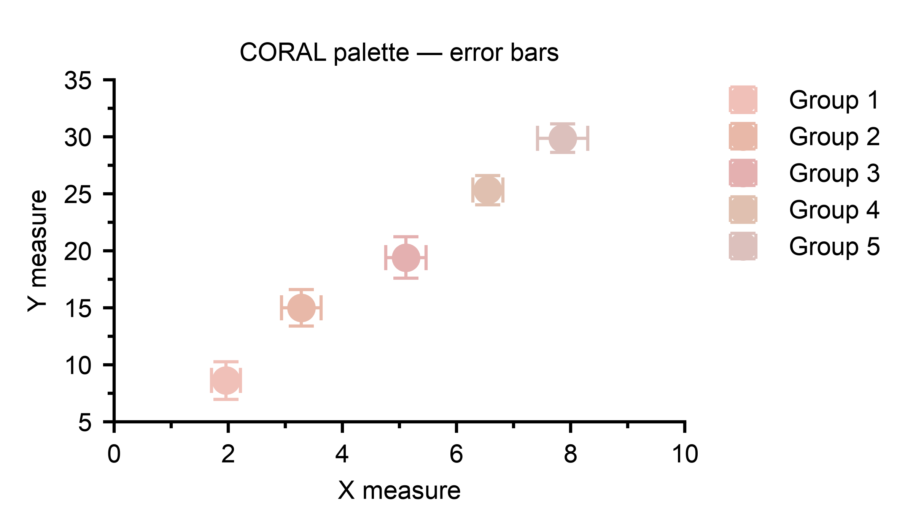</td>
  </tr>
  <tr>
    <td colspan="2">Group means with x and y error bars in <code>CORAL</code></td>
  </tr>
</table>

Generated by [`examples/palettes_demo.py`](examples/palettes_demo.py), which also produces the
palette swatches and the `get_colors` figure above:

<table>
  <tr>
    <td>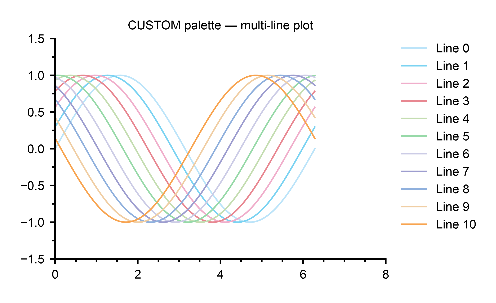</td>
    <td>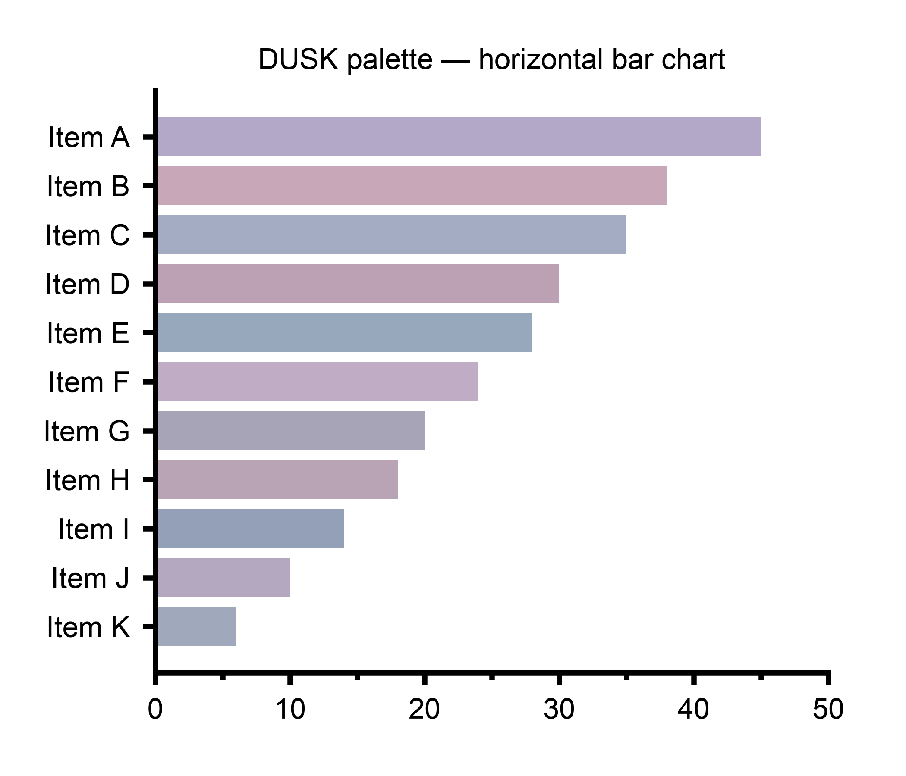</td>
  </tr>
  <tr>
    <td>All 11 <code>CUSTOM</code> colors as lines</td>
    <td>Horizontal bar chart in <code>DUSK</code></td>
  </tr>
  <tr>
    <td>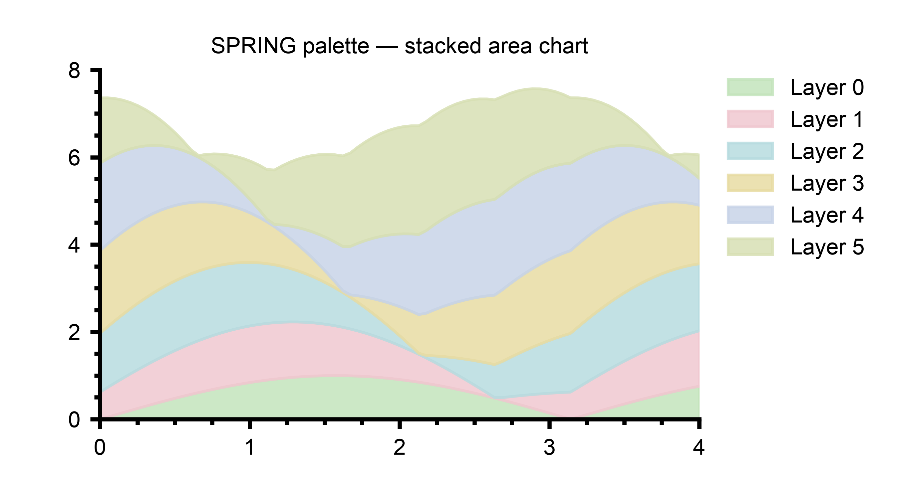</td>
    <td>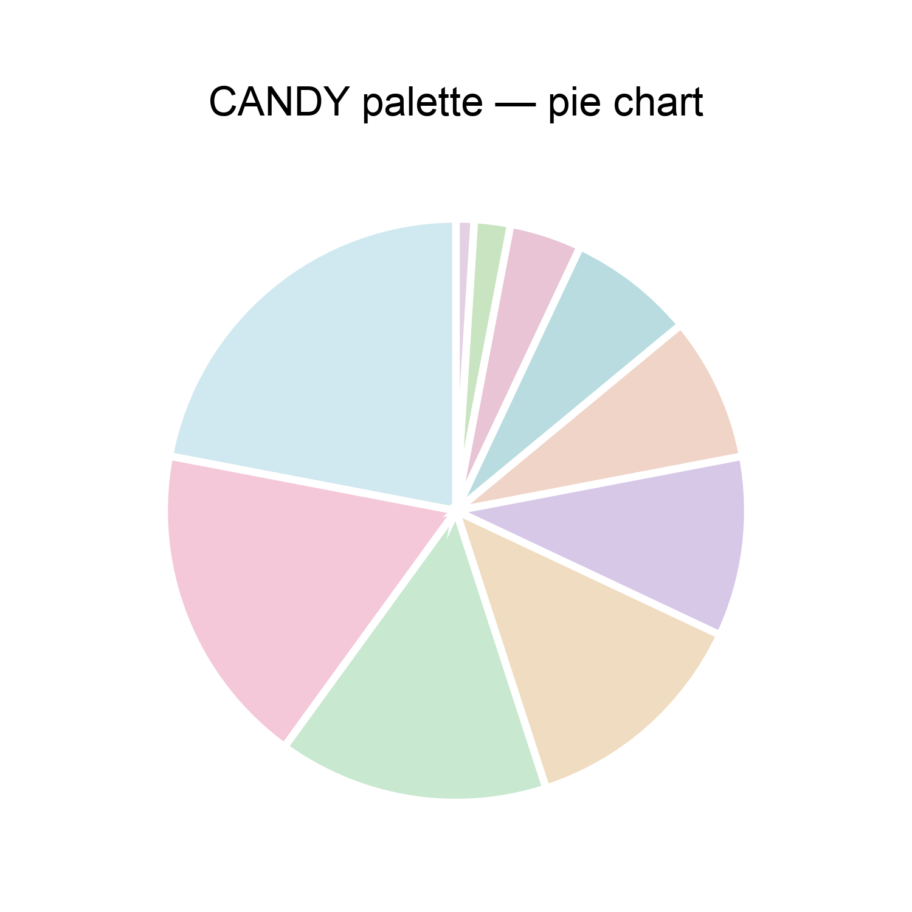</td>
  </tr>
  <tr>
    <td>Stacked area chart in <code>SPRING</code></td>
    <td>Pie chart in <code>CANDY</code></td>
  </tr>
  <tr>
    <td colspan="2">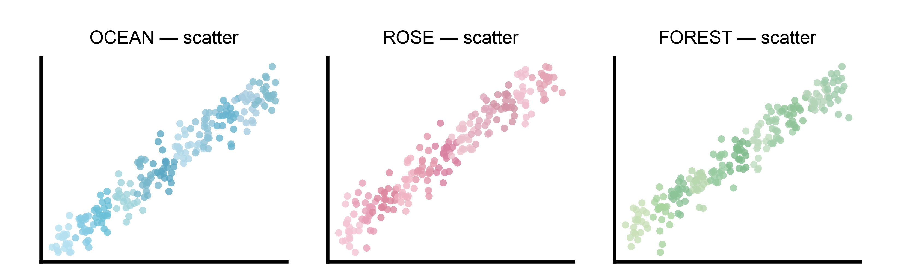</td>
  </tr>
  <tr>
    <td colspan="2">Scatter plots in <code>OCEAN</code>, <code>ROSE</code>, and <code>FOREST</code></td>
  </tr>
</table>

To regenerate the images, run the scripts from any directory. Each figure is written to
`examples/`, next to the scripts, as PNG (600 dpi), SVG, and PDF:

```bash
python examples/styles_demo.py
python examples/personal_demo.py
python examples/palettes_demo.py
```

The images use the Personal style, except the `graphpadprism_*` images in the GraphPadPrism style
and the Matplotlib-defaults comparison at the top of this README. Each figure is laid out in round
inches (its size, the position and size of each axes, and the anchors of legends and titles), and
the files are saved uncropped with `save_figure`, so they keep that size. The README shows every
image at 100 pixels per inch of figure width, so the text of each figure appears at the same scale.
Variables in labels and legends are math text, such as `$x$` and `$\sin(x)$`. The scripts need
Arial Regular and Italic installed and exit with an error without them, instead of writing images
in a fallback font.

## Development

```bash
git clone https://github.com/FridrichMethod/mplplots.git
cd mplplots
python -m venv .venv
source .venv/bin/activate
pip install -e ".[dev]"

pre-commit run --all-files  # ruff lint + format, mypy
pytest
```

Both checks must pass before you commit. CI runs them on Python 3.12 and 3.13 for pushes and pull
requests to `main`, and runs the tests once more against the oldest supported versions (Python
3.12 with Matplotlib 3.8.0). Agent and contributor conventions are in [`AGENTS.md`](AGENTS.md).

## License

[MIT](LICENSE), copyright 2025 Zhaoyang Li.
