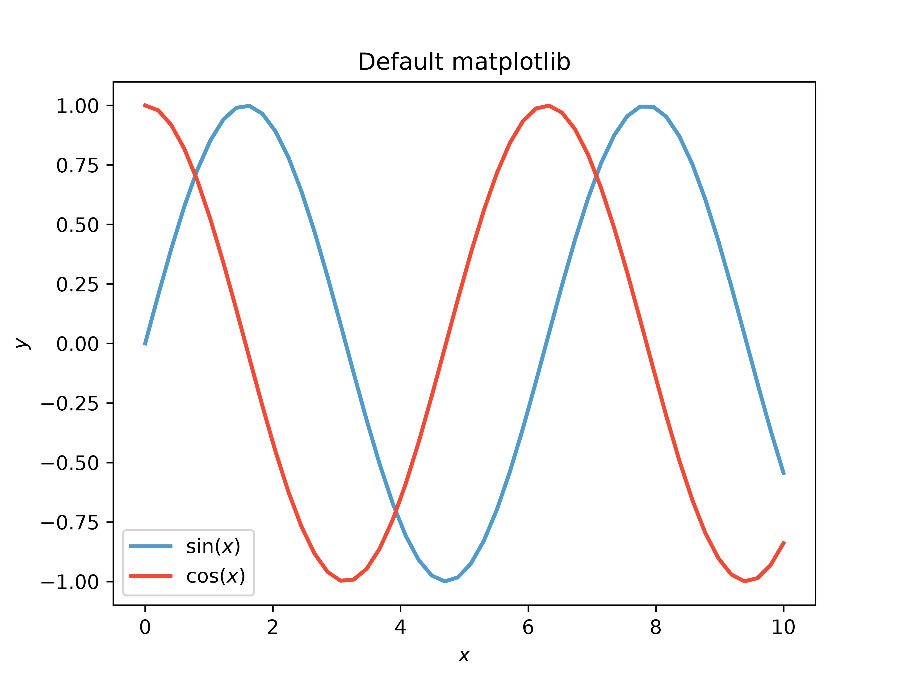
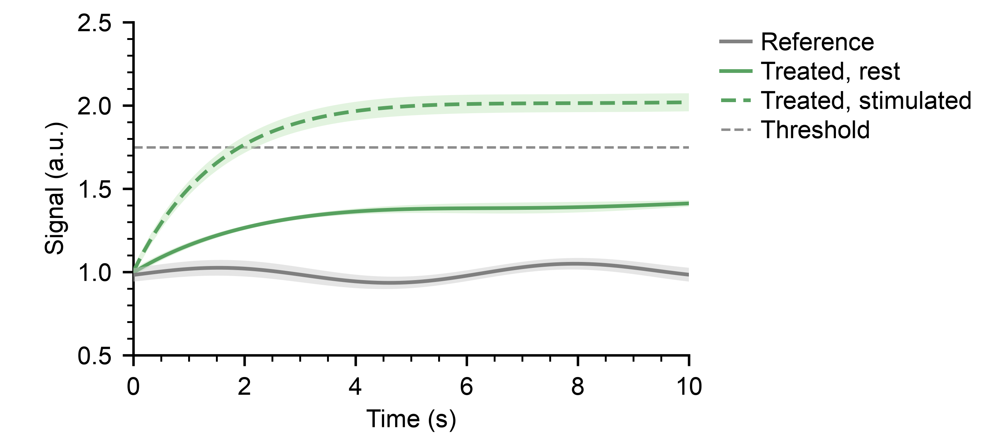
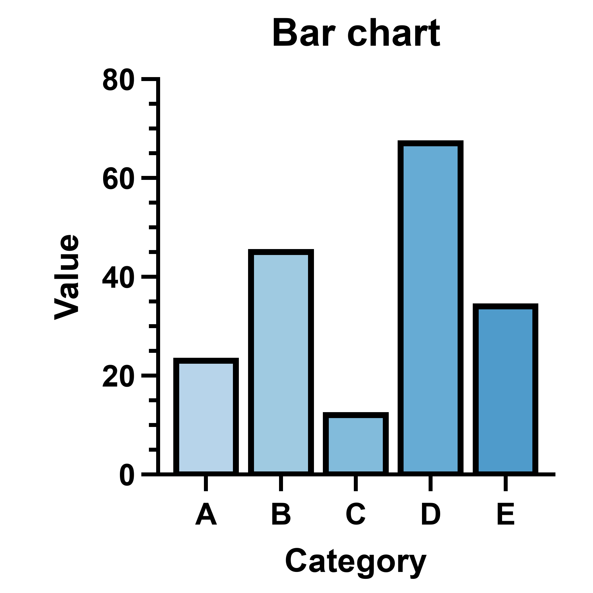
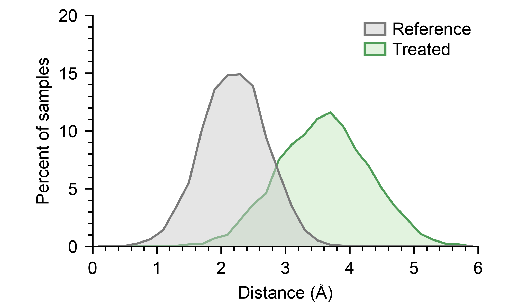

# mplplots

[](https://github.com/FridrichMethod/mplplots/actions/workflows/ci.yml)
[](pyproject.toml)
[](LICENSE)

**Publication figures from plain Matplotlib.** Matplotlib's defaults suit a screen, not a journal
page. mplplots adds two styles and the toolkit that a style file alone cannot provide: axes
measured in inches, Prism-like ticks, curated palettes, reproducible export, and a checker that
tests each finished figure against its style. Math text needs no LaTeX installation.

<table>
  <tr>
    <th>Matplotlib defaults</th>
    <th><code>mplplots.styles.Personal</code> + <code>auto_ticks</code></th>
  </tr>
  <tr>
    <td></td>
    <td></td>
  </tr>
</table>

Both images are shown at the same scale: Matplotlib's default 6.4 by 4.8 in canvas, and a 3 by
2.25 in figure that fits a 3.5 in journal column, with all text at 8 pt.

## Why mplplots

- **[Two styles](docs/styles.md).** `Personal`, the default: Arial 8 pt text, thin 0.8 pt axes,
  and no top or right spines. `GraphPadPrism`: the default graphs of GraphPad Prism 11, measured
  from the files Prism exports.
- **[Prism-like ticks](docs/ticks.md).** `auto_ticks` picks about six round major ticks and starts
  and ends each axis on a major tick; the Personal style puts one minor tick halfway between major
  ticks.
- **[Layout in inches](docs/layout.md).** Set each axis length directly, as Prism does, or start
  from a journal column width (3.5, 5, or 7 in); the saved file has exactly the figure's size.
- **[Curated colors](docs/colors.md).** 25 hand-picked palettes, six colormap families, and
  `ColorPair`s that give each condition a line color and a pale fill, with a contrast check.
- **[Plot helpers](docs/plots.md).** Mean +/- SEM bands and binned distributions in one fixed
  form, and significance stars from p-values.
- **[Reproducible files](docs/saving.md).** PNG at 600 dpi, SVG, and PDF with editable TrueType
  text instead of the Type 3 fonts that some journal checks reject; saving the same figure again
  writes the same bytes.
- **[A style check](docs/checking.md).** `assert_figure` fails on off-style text sizes and fonts,
  framed legends, and text that runs off the canvas, and warns about stray spines and overlapping
  labels.
- **[Agent-ready](docs/coding-agents.md).** A skill and the style guide for Claude Code and Codex,
  installed with `mplplots install-skill`, and a rules snippet for a project's agent instructions.

## Installation

```bash
pip install git+https://github.com/FridrichMethod/mplplots.git
```

mplplots needs Python 3.12 or newer and Matplotlib 3.8 or newer. It is not on PyPI; to pin a
release, install its tag:
`pip install git+https://github.com/FridrichMethod/mplplots.git@v0.5.0`.
[`CHANGELOG.md`](CHANGELOG.md) lists what each release changed. Install Arial for final figures;
without it the styles fall back to a similar font without warnings (see
[Fonts](docs/styles.md#fonts)).

## Quick start

```python
import numpy as np

import mplplots as mpp

mpp.use()  # the Personal style, before the first figure is created

TREATED = mpp.ColorPair(fill="#c7e9c0", edge="#4f9d58")  # one role of a project palette

t = np.linspace(0, 10, 101)
mean, sem = 1 - np.exp(-t / 2), np.full_like(t, 0.05)

fig, (ax,) = mpp.grid_inches(width=2.5, height=1.5)  # 2.5 by 1.5 in axes in a 3.3 by 2 in figure
mpp.plot_mean_sem(ax, t, mean, sem, fill=TREATED.fill, edge=TREATED.edge, label="Treated")
mpp.auto_ticks(ax, left=0, right=10, bottom=0, top=1.2)  # round ticks, after plotting
ax.set(xlabel="Time (s)", ylabel="Signal (a.u.)")
ax.legend(loc="lower right")

mpp.assert_figure(fig)  # raises StyleError if the figure breaks a rule of the style
mpp.save_figure(fig, "figures/signal", caption="Mean of n = 6 replicates; the band is 1 SEM.")
```

`save_figure` writes `figures/signal.png` (600 dpi), `.pdf` and `.svg`, each exactly 3.3 by 2 in,
and the caption draft `figures/signal_caption.txt`. The functions and constants of the styles and
the toolkit are all importable from the top-level package, as `mpp.<name>`; the palettes live in
`mplplots.palettes`.

Already have a plotting script? Each style is an ordinary Matplotlib style file, so one line
restyles it, with no other mplplots code:

```python
import matplotlib.pyplot as plt

plt.style.use("mplplots.styles.Personal")  # or "mplplots.styles.GraphPadPrism"
```

## Gallery

<table>
  <tr>
    <td></td>
    <td></td>
  </tr>
  <tr>
    <td>A 2 by 2 <code>grid_inches</code> layout with shared axes</td>
    <td>Bars, replicates, 95% t intervals, and <code>significance_stars</code></td>
  </tr>
  <tr>
    <td></td>
    <td></td>
  </tr>
  <tr>
    <td>Mean +/- SEM bands with <code>plot_mean_sem</code></td>
    <td>The <code>GraphPadPrism</code> style, with Prism's black bar borders</td>
  </tr>
  <tr>
    <td colspan="2"></td>
  </tr>
  <tr>
    <td colspan="2">Binned distributions with <code>plot_distribution</code></td>
  </tr>
</table>

Every example figure, with the script that draws it, is in the [gallery](docs/gallery.md).

## Documentation

| Page | What it covers |
| --- | --- |
| [Styles](docs/styles.md) | `Personal` and `GraphPadPrism`: applying and combining them, every setting they change, fonts |
| [Ticks](docs/ticks.md) | The minor ticks of the styles and `auto_ticks` |
| [Layout in inches](docs/layout.md) | Axes, legends, and titles placed in inches, grids of panels, margins, colorbars |
| [Colors](docs/colors.md) | Palettes, colormap families, color cycles, `get_colors`, and color pairs |
| [Plot helpers](docs/plots.md) | Mean +/- SEM bands, binned distributions, significance stars, boxed axes |
| [Saving figures](docs/saving.md) | `save_figure`: formats, exact size, and reproducible output |
| [Checking a figure](docs/checking.md) | `check_figure`, `assert_figure`, and the rules they test |
| [For coding agents](docs/coding-agents.md) | The skill, the rules snippet, the style guide, and the `mplplots` command |
| [Gallery](docs/gallery.md) | Every example figure and how to regenerate the images |
| [Development](docs/development.md) | Setting up a clone, the checks, and CI |

The [documentation index](docs/README.md) lists the same pages.

## License

[MIT](LICENSE), copyright 2025 Zhaoyang Li.
