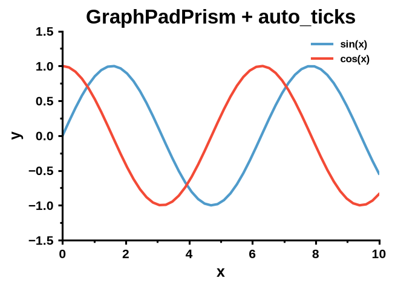
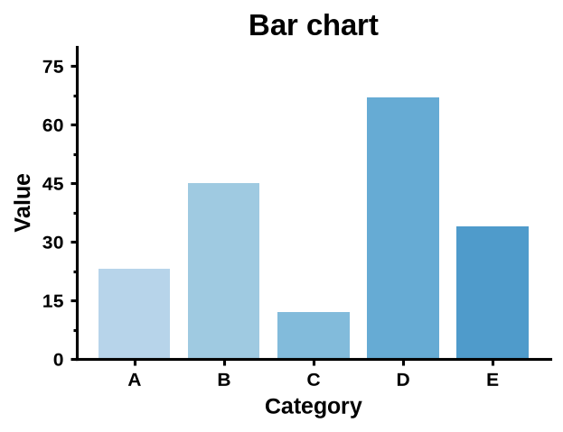
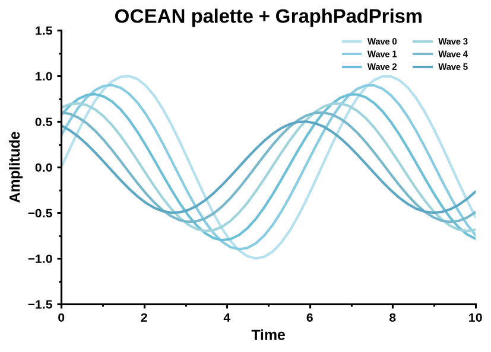
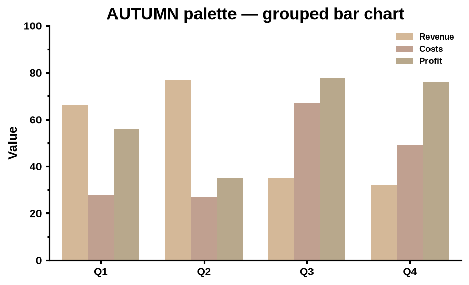
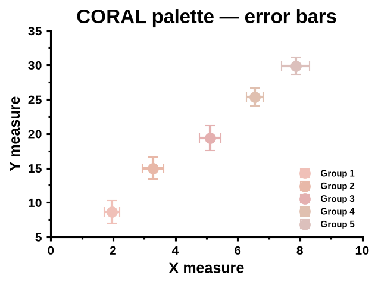

# mplplots

Drop-in Matplotlib/Seaborn styling: a GraphPad Prism-style `.mplstyle` sheet, curated color
palettes, and a few helpers for publication-quality scientific figures.

<table>
  <tr>
    <th>Matplotlib defaults</th>
    <th><code>mplplots.styles.GraphPadPrism</code> + <code>auto_ticks</code></th>
  </tr>
  <tr>
    <td></td>
    <td></td>
  </tr>
</table>

## Installation

```bash
pip install git+https://github.com/FridrichMethod/mplplots.git
```

mplplots is not on PyPI. It needs Python 3.12 or newer. Loading the style by package name (below)
needs Matplotlib 3.7 or newer.

## Quick start

```python
import matplotlib.pyplot as plt
import numpy as np

from mplplots.palettes import BLUES, REDS
from mplplots.utils import auto_ticks

plt.style.use("mplplots.styles.GraphPadPrism")

x = np.linspace(0, 10, 50)
fig, ax = plt.subplots()
ax.plot(x, np.sin(x), color=BLUES[4], label="sin(x)")
ax.plot(x, np.cos(x), color=REDS[4], label="cos(x)")
ax.set_xlabel("x")
ax.set_ylabel("y")
ax.legend()
auto_ticks(ax, left=0, right=10, bottom=-1.2, top=1.2)
fig.savefig("figure.png")
```

## Applying the style

The style ships inside the package, and Matplotlib can load it by its dotted package name. You do
not need to know where the file is installed.

```python
import matplotlib.pyplot as plt

plt.style.use("mplplots.styles.GraphPadPrism")  # for the rest of the session
```

The package also has a shortcut and the path to the file:

```python
import mplplots

mplplots.prism_style()  # same as plt.style.use(mplplots.STYLE_PATH)
mplplots.STYLE_PATH  # pathlib.Path to the bundled GraphPadPrism.mplstyle
```

To apply it to a single block of code only:

```python
import matplotlib.pyplot as plt

with plt.style.context("mplplots.styles.GraphPadPrism"):
    fig, ax = plt.subplots()
    ax.plot([1, 2, 3], [1, 4, 9])
    fig.savefig("prism.png")
```

Styles can be combined. Later entries override earlier ones, so put the Prism style last to keep
its fonts, spines, and sizes on top of another style (here, seaborn's white grid):

```python
import matplotlib.pyplot as plt

plt.style.use(["seaborn-v0_8-whitegrid", "mplplots.styles.GraphPadPrism"])
```

With seaborn, apply the style after `sns.set_theme(...)`, because `set_theme` rewrites the same
settings:

```python
import matplotlib.pyplot as plt
import seaborn as sns

sns.set_theme(style="ticks")
plt.style.use("mplplots.styles.GraphPadPrism")
```

**Without installing mplplots.** `GraphPadPrism.mplstyle` is an ordinary Matplotlib style file.
You can copy [`src/mplplots/styles/GraphPadPrism.mplstyle`](src/mplplots/styles/GraphPadPrism.mplstyle)
anywhere and load it with `plt.style.use("path/to/GraphPadPrism.mplstyle")`. You can also put it in
the `stylelib/` folder of your Matplotlib config directory (`matplotlib.get_configdir()`) and use
`plt.style.use("GraphPadPrism")` from any project.

### What the style changes

| Area | Settings |
| --- | --- |
| Figure | 4.5 × 3 in at 300 dpi. `savefig` crops to a tight bounding box. |
| Text | Arial (see [Fonts](#fonts)), bold throughout. The base size is 14 pt, axis labels are 12 pt, titles 16 pt, tick labels 10 pt, and the legend 8 pt. Math text (`$...$`) uses the same font. |
| Axes | 1.5 pt axis lines, with the top and right spines removed. Autoscaled limits are rounded out to tick values. |
| Ticks | 1.5 pt major and minor ticks, with minor ticks shown on both axes. |
| Lines & markers | 2 pt lines. Markers are solid black by default (pass `markerfacecolor`/`markeredgecolor` to change them). Error bars have 3 pt caps. |
| Legend | No frame, placed in the upper right. |

For every setting, see the [style file](src/mplplots/styles/GraphPadPrism.mplstyle).

### Fonts

The style asks for Arial, which is GraphPad Prism's default font. If Arial is not installed (common
on Linux and HPC clusters), it falls back without warnings to Helvetica or an Arial-compatible
clone (Liberation Sans, Arimo, Nimbus Sans), and finally to DejaVu Sans, which ships with
Matplotlib. Math text follows the same chain. For the exact Prism look, install Arial, or register
the font files at the start of your script or notebook, before plotting:

```python
from mplplots.utils import add_custom_fonts

add_custom_fonts("/path/to/Arial.ttf", "/path/to/Arial Bold.ttf")
```

`add_custom_fonts` registers the files for the current Python session only. Register the bold face
as well, because the style uses bold text everywhere. Matplotlib caches its font list. If you
install Arial system-wide after Matplotlib has already run, delete the `fontlist-*.json` file in
`matplotlib.get_cachedir()` so the list is rebuilt.

## Color palettes

`mplplots.palettes` provides 25 hand-picked palettes of 11 colors each, and six single-hue families
sampled from Matplotlib colormaps. Every palette is a plain tuple of hex strings. You can index or
slice it and pass it anywhere Matplotlib or seaborn accepts colors.

| Group | Palettes |
| --- | --- |
| Mixed hues | `CUSTOM`, `PASTEL`, `WARM`, `COOL`, `EARTH` |
| Single color family (from `CUSTOM`) | `OCEAN`, `ROSE`, `FOREST`, `LAVENDER`, `SUNSET`, `COASTAL` |
| Seasonal | `SPRING`, `SUMMER`, `AUTUMN`, `WINTER` |
| Time of day | `DAWN`, `DUSK` |
| Thematic | `CANDY`, `SMOKE`, `VINTAGE`, `NORDIC`, `MEADOW`, `CORAL`, `TROPICAL`, `POWDER` |

<details>
<summary>Show all 25 palettes</summary>


</details>

The colormap families `BLUES`, `GREENS`, `REDS`, `PURPLES`, `ORANGES`, and `GREYS` each have 8
shades running from light to dark. Their colors are sampled from the matching Matplotlib colormap
between 0.3 and 0.8 (0.25 and 0.75 for `GREYS`), which skips near-white and near-black.


### Using a palette

```python
import matplotlib.pyplot as plt
import numpy as np

from mplplots.palettes import BLUES, OCEAN

x = np.linspace(0, 10, 100)
fig, (ax1, ax2) = plt.subplots(1, 2)
ax1.plot(x, np.sin(x), color=OCEAN[0])  # a single color
for i, color in enumerate(OCEAN[1:4]):  # a slice
    ax1.plot(x, np.sin(x + i + 1), color=color)
ax2.bar(["A", "B", "C"], [3, 5, 4], color=BLUES[2:5])
```

### Making a palette the default color cycle

`set_palette` sets Matplotlib's color cycle (`rcParams["axes.prop_cycle"]`), so a palette applies
without passing `color=` on every call. `PALETTES` maps every palette name to its colors.

```python
from mplplots.palettes import PALETTES, set_palette

set_palette("ocean")  # palette name, case-insensitive
set_palette(["#000000", "#E69F00"])  # or any sequence of colors

PALETTES["OCEAN"]  # read-only mapping: UPPER-CASE name -> tuple of hex colors
sorted(PALETTES)  # every named palette, including the six colormap families
```

An unknown name raises `ValueError`. The new cycle applies to axes created after the call. Call
`set_palette` after `plt.style.use(...)`, because a style that defines its own color cycle would
replace it.

Each of the 25 hand-picked palettes also has a `<NAME>_CYCLE` object, such as `OCEAN_CYCLE`. Each
one is a single `itertools.cycle` shared by all code that imports it. Colors drawn from it with
`next(...)` therefore carry over between figures and notebook re-runs. Prefer `set_palette(...)`,
or create a fresh cycle where you need one:

```python
from itertools import cycle

from mplplots.palettes import OCEAN

colors = cycle(OCEAN)
```

### Sampling any colormap

`get_colors(name, n, start=0.2, end=0.8)` returns `n` evenly spaced hex colors from any registered
Matplotlib colormap. The default range skips the extreme ends of the colormap, and `n=1` returns
the color at the midpoint.

```python
from mplplots.palettes import get_colors

get_colors("viridis", 5)  # 5 colors between 0.2 and 0.8 of viridis
get_colors("coolwarm", 6, start=0.15, end=0.85)  # a wider range
get_colors("Blues_r", 3)  # reversed colormaps work too
```


## Ticks: `auto_ticks`

```python
import matplotlib.pyplot as plt

from mplplots.utils import auto_ticks

plt.style.use("mplplots.styles.GraphPadPrism")

fig, ax = plt.subplots()
ax.bar(["A", "B", "C"], [23, 45, 12])
auto_ticks(ax, bottom=0)  # call after plotting; keep the y-axis starting at 0
```

`auto_ticks(ax, left=..., right=..., bottom=..., top=...)` gives both axes Prism-like ticks:

- **Major ticks:** about six, on round values.
- **Minor ticks:** the number of subdivisions depends on the major tick count. Six or more major
  ticks get 1 minor tick between them, five get 3, and four or fewer get 4.
- **Limits:** any limit you leave unset moves to the first or last major tick, so each axis starts
  and ends on a labelled tick. Pass `left`, `right`, `bottom`, or `top` to keep that limit fixed,
  for example `bottom=0` for bar charts.

Call it **after** plotting your data, because it works from the limits the data produce. It
replaces the major tick locators on both axes. If you set custom tick positions or labels (for
example, the group labels of a grouped bar chart), set them after calling `auto_ticks`.

## Gallery

Generated by [`examples/styles_demo.py`](examples/styles_demo.py):

<table>
  <tr>
    <td></td>
    <td></td>
  </tr>
  <tr>
    <td>Bar chart colored with <code>BLUES[:5]</code></td>
    <td>Phase-shifted waves in <code>OCEAN</code></td>
  </tr>
  <tr>
    <td></td>
    <td></td>
  </tr>
  <tr>
    <td>Grouped bar chart in <code>AUTUMN</code></td>
    <td>Group means with x and y error bars in <code>CORAL</code></td>
  </tr>
</table>

Generated by [`examples/palettes_demo.py`](examples/palettes_demo.py), which also produces the
palette swatches and the `get_colors` figure above:

<table>
  <tr>
    <td></td>
    <td></td>
  </tr>
  <tr>
    <td>All 11 <code>CUSTOM</code> colors as lines</td>
    <td>Scatter plots in <code>OCEAN</code>, <code>ROSE</code>, and <code>FOREST</code></td>
  </tr>
  <tr>
    <td></td>
    <td></td>
  </tr>
  <tr>
    <td>Stacked area chart in <code>SPRING</code></td>
    <td>Horizontal bar chart in <code>DUSK</code></td>
  </tr>
  <tr>
    <td></td>
    <td></td>
  </tr>
  <tr>
    <td>Pie chart in <code>CANDY</code></td>
    <td></td>
  </tr>
</table>

To regenerate the images, run the scripts from any directory. The images are written to
`examples/`, next to the scripts:

```bash
python examples/styles_demo.py
python examples/palettes_demo.py
```

## Development

```bash
git clone https://github.com/FridrichMethod/mplplots.git
cd mplplots
python -m venv .venv
source .venv/bin/activate
pip install -e ".[dev]"

pre-commit run --all-files  # ruff lint + format, mypy
pytest
```

Both checks must pass before you commit. CI runs them on Python 3.12 and 3.13 for pushes and pull
requests to `main`. Agent and contributor conventions are in [`AGENTS.md`](AGENTS.md).

## License

[MIT](LICENSE), copyright 2025 Zhaoyang Li.
