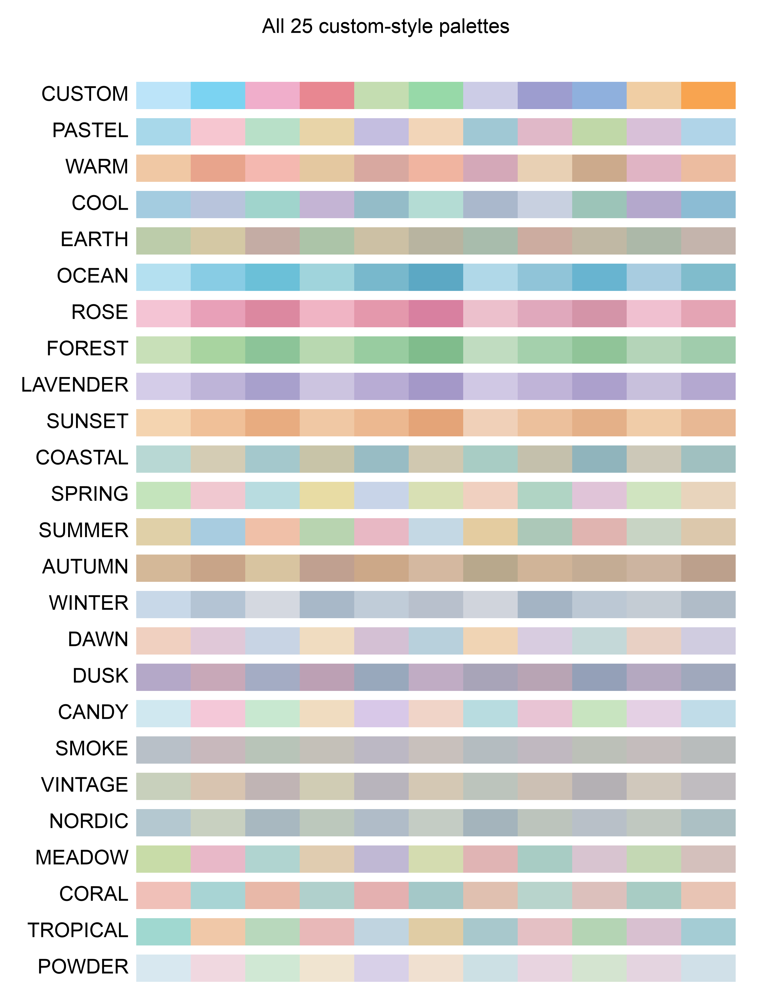
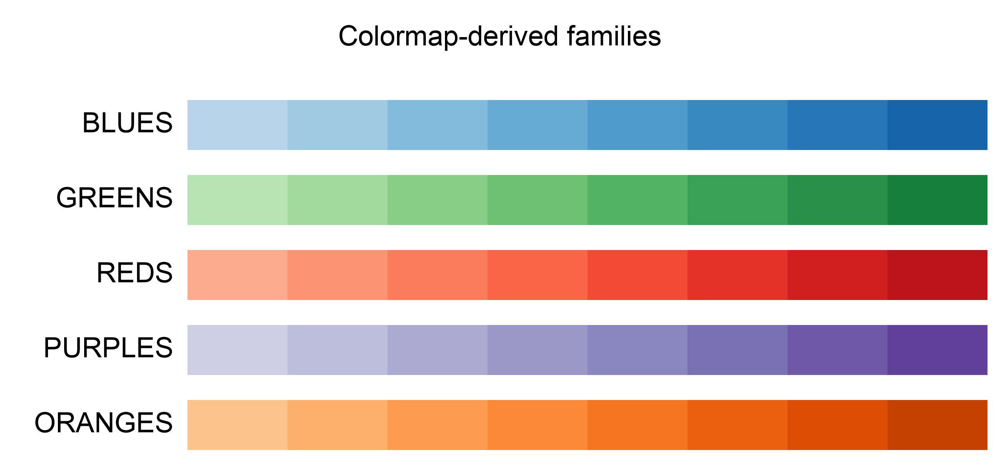
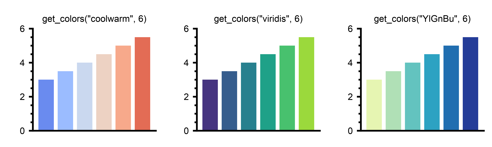

# Colors

`mplplots.palettes` holds named palettes and a sampler for any Matplotlib colormap, and
`mplplots.colors` holds the color rules of the Personal style: fill and edge pairs, lighter and
darker shades, contrast checks, and alpha and line constants.

## Color palettes

`mplplots.palettes` provides 25 hand-picked palettes of 11 colors each, and six single-hue families
sampled from Matplotlib colormaps. Every palette is a plain tuple of hex strings. You can index or
slice it and pass it anywhere Matplotlib or seaborn accepts colors.

| Group | Palettes |
| --- | --- |
| Mixed hues | `CUSTOM`, `PASTEL`, `WARM`, `COOL`, `EARTH` |
| Single color family (from `CUSTOM`) | `OCEAN`, `ROSE`, `FOREST`, `LAVENDER`, `SUNSET`, `COASTAL` |
| Seasonal | `SPRING`, `SUMMER`, `AUTUMN`, `WINTER` |
| Time of day | `DAWN`, `DUSK` |
| Thematic | `CANDY`, `SMOKE`, `VINTAGE`, `NORDIC`, `MEADOW`, `CORAL`, `TROPICAL`, `POWDER` |

<details>
<summary>Show all 25 palettes</summary>



</details>

The colormap families `BLUES`, `GREENS`, `REDS`, `PURPLES`, `ORANGES`, and `GREYS` each have 8
shades running from light to dark. Their colors are sampled from the matching Matplotlib colormap
between 0.3 and 0.8 (0.25 and 0.75 for `GREYS`), which skips near-white and near-black.



### Using a palette

```python
import matplotlib.pyplot as plt
import numpy as np

import mplplots as mpp
from mplplots.palettes import BLUES, OCEAN

mpp.use()

x = np.linspace(0, 10, 100)
fig, (ax1, ax2) = plt.subplots(1, 2)
ax1.plot(x, np.sin(x), color=OCEAN[0])  # a single color
for i, color in enumerate(OCEAN[1:4]):  # a slice
    ax1.plot(x, np.sin(x + i + 1), color=color)
ax2.bar(["A", "B", "C"], [3, 5, 4], color=BLUES[2:5])
```

### Making a palette the default color cycle

`set_palette` sets Matplotlib's color cycle (`rcParams["axes.prop_cycle"]`), so a palette applies
without passing `color=` on every call. `PALETTES` maps every palette name to its colors.

```python
import mplplots as mpp
from mplplots.palettes import PALETTES, set_palette

mpp.use()
set_palette("ocean")  # palette name, case-insensitive
set_palette(["#000000", "#E69F00"])  # or any sequence of colors

PALETTES["OCEAN"]  # read-only mapping: UPPER-CASE name -> tuple of hex colors
sorted(PALETTES)  # every named palette, including the six colormap families
```

An unknown name raises `ValueError`. The new cycle applies to axes created after the call. Call
`set_palette` after `mpp.use()`, because a style that defines its own color cycle would replace
it.

To step through a palette by hand, create a cycle over it:

```python
from itertools import cycle

from mplplots.palettes import OCEAN

colors = cycle(OCEAN)
```

### Sampling any colormap

`get_colors(name, n, start=0.2, end=0.8)` returns `n` evenly spaced hex colors from any registered
Matplotlib colormap. The default range skips the extreme ends of the colormap, and `n=1` returns
the color at the midpoint.

```python
from mplplots.palettes import get_colors

get_colors("viridis", 5)  # 5 colors between 0.2 and 0.8 of viridis
get_colors("coolwarm", 6, start=0.15, end=0.85)  # a wider range
get_colors("Blues_r", 3)  # reversed colormaps work too
get_colors("viridis", 5, start=0.8, end=0.2)  # or sample in reverse order
```

`n` must be at least 1, and `start` and `end` must be between 0 and 1. Otherwise, and for an
unknown colormap name, `get_colors` raises `ValueError`.



## Color pairs

`mplplots.colors` holds the color rules of the Personal style. A project keeps its colors in one
palette module that maps each role (a condition, a sample, a reference) to a `ColorPair`. The
edge carries the role's identity: lines, marker edges, bar borders. The fill is its pale partner,
drawn under alpha: bands, bar faces, scatter faces.

```python
import mplplots as mpp

REFERENCE = mpp.ColorPair(fill="#cccccc", edge="#7a7a7a")
TREATED = mpp.ColorPair(fill="#c7e9c0", edge="#4f9d58")
PALETTE = {"reference": REFERENCE, "treated": TREATED}

fill, edge = TREATED  # a ColorPair unpacks as fill, edge
assert mpp.check_palette(PALETTE) == []  # put this in the project's tests

mpp.lighten("#dd6692", 0.3)  # '#efb5ca': HLS lightness times 1.3
mpp.darken("#006d2c", 0.25)  # '#005221': HLS lightness times 0.75
mpp.contrast_ratio("#4f9d58", alpha=mpp.LINE_ALPHA)  # 3.11: WCAG contrast on white
```

- `lighten(color, amount=0.4)` and `darken(color, amount=0.3)` multiply the HLS lightness by
  `1 + amount` or `1 - amount` and return a lowercase `#rrggbb`. Use them to derive a further
  member of a hue family instead of adding a new color.
- `relative_luminance(color)` is the WCAG relative luminance, and
  `contrast_ratio(color, background="white", *, alpha=1.0)` the WCAG contrast ratio of `color`
  drawn at `alpha` over `background`.
- `check_palette(palette, *, min_edge_contrast=3.0, alpha=LINE_ALPHA, floors=None)` returns one
  message per violation and an empty list for a sound palette: an edge that is not darker than its
  fill, two roles that share an edge color, or an edge whose contrast on white, drawn at `alpha`,
  is below `min_edge_contrast` (3 by default). `floors={"role": 1.8}` gives a lighter warm hue (a
  yellow, say) its own floor.

### Alpha and line constants

| Constant | Value | Use |
| --- | --- | --- |
| `SCATTER_ALPHA` | `0.6` | Scatter dots, histogram and density fills |
| `BAND_ALPHA` | `0.5` | Mean +/- SEM bands and confidence bands |
| `LINE_ALPHA` | `0.95` | Curves |
| `REFERENCE_LINE` | `{"color": "0.55", "linestyle": "--", "linewidth": 0.8}` | Reference and threshold lines: `ax.axhline(1.0, **mpp.REFERENCE_LINE)` |
| `SECONDARY_LINESTYLE` | `(0, (4, 2))` | The dash pattern of a second variable within one hue |
